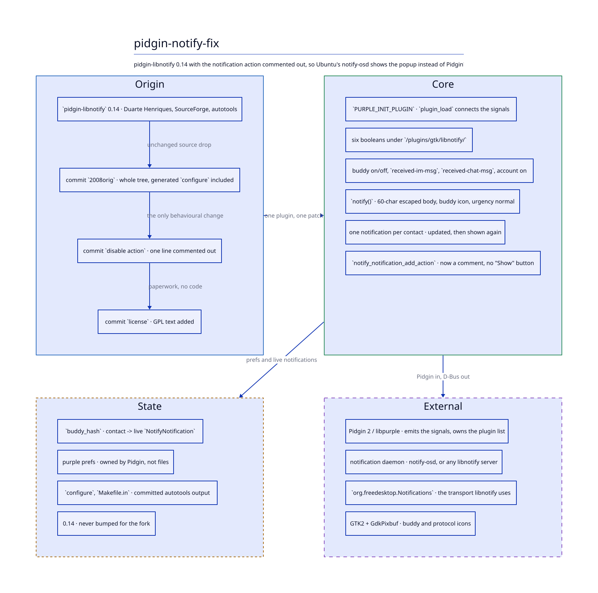

# pidgin-notify-fix

A 2008 `pidgin-libnotify` 0.14 tree with exactly one line commented out, so Pidgin message popups appear through Ubuntu's notify-osd instead of Pidgin's messagebox.

Read it left to right:

- **This is a frozen fork, not a maintained plugin.** The whole upstream tree was imported in one commit, `configure` and `Makefile.in` included, and the only later changes are one edited line and a GPL copy. It targets the Pidgin/libpurple 2 API (`purple >= 2.0.0`, GTK2), and the version string still says 0.14.
- **The fix is the removal of the action, not an addition.** `notify_notification_add_action(notification, "show", _("Show"), …)` is commented out, so the popup has no clickable button and becomes a plain notification. The repository only states the effect ("show with notify-osd instead of messagebox"); it never records *why* an action made notify-osd drop the popup, so that part is observed behaviour, not documented design.
- **Everything else is upstream design.** `plugin_load` connects libpurple signals (buddy signed on/off, `received-im-msg`, `received-chat-msg`, account signed on), and each message builds a notification whose body is truncated to 60 UTF-8 characters and markup-escaped before it is sent.
- **One live notification per contact.** `buddy_hash` keeps the open `NotifyNotification` keyed by contact, so a second message from the same person updates the existing popup and calls `show` again instead of stacking new ones; the buddy icon (or the protocol icon) is attached, urgency is always `NORMAL`, and closing the popup removes it from the hash.
- **Nothing lives in this repo's own state.** The six toggles (`newmsg`, `blocked`, `newconvonly`, `signon`, `signoff`, `only_available`) are Pidgin preferences under `/plugins/gtk/libnotify/`, and there is no config file, no daemon and no D-Bus code of its own — libnotify talks to `org.freedesktop.Notifications` for it.

Diagram source: [`docs/system.d2`](docs/system.d2) · renderer: [`scripts/render-diagram.sh`](scripts/render-diagram.sh).
